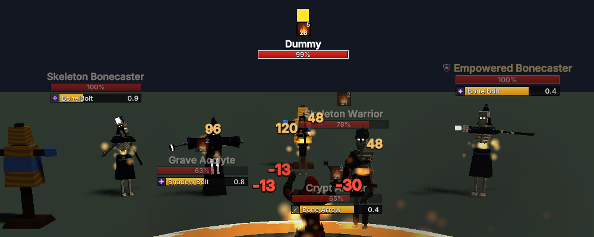
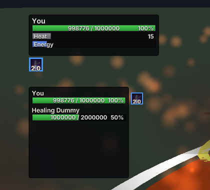
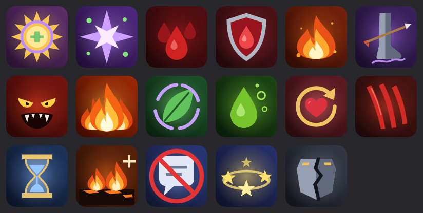

# Buffs and debuffs, and the diagonal run

Working document for the aura pass: every lasting effect in the game shown as an icon, where
those icons are drawn, and the diagonal-run turn that came with it.

Status: **COMPLETE**. See [Known limitations](#known-limitations).



*Monster lab, `--autocast --vsync`, about 12 s in: Ignite stacks over the name of every enemy the
mage has hit.*

## What the player sees

| where | what | how |
| --- | --- | --- |
| over every nameplate | every debuff on that enemy | a centred row over the name, six to a line, twelve at most |
| under every nameplate | every buff on that enemy (a frenzy) | a centred row under the health bar; the cast bar hangs under it |
| under the player frame | every debuff on the player | two lines of eight, attached to the frame: moving or scaling the frame in Edit HUD takes them along |
| the **BUFFS** element | every buff on the player | two lines of eight, filling from the top-right corner; placed, scaled and hidden in Edit HUD like any frame |
| beside each party row | that member's debuffs | up to four, outside the frame's right edge |
| inside each raid cell | that member's debuffs | up to three, small, along the cell's bottom-left, no countdown |

Every icon, everywhere, is drawn by one widget (`ui/aura_row.rs`):

* the effect's own art, on a dark backing;
* a **blue border** (`DISPEL_BORDER`) when a dispel can remove it; any other icon only has a
  black hairline so it keeps an edge against bright spell effects;
* a darkening wipe from the top for the share of its duration already gone;
* the seconds left along the bottom (`12`, `1.4`, `5m`), the stack count in the top-right
  corner;
* **a tooltip on hover**: the name (red for a debuff), what kind of thing it is — the dispel
  school in its colour (`Magic` blue, `Poison` green, `Curse` violet, `Disease` ochre) or
  `Buff` / `Debuff` — one sentence of what it does, and the time, stacks or absorb left. The
  tooltip panel of a dispellable debuff is edged in the dispel blue as well.



*Crypt Archer's Crippling Arrow (a curse, so dispellable) under the player frame and beside the
player's party row.*

### Dispellable or not

Nothing new decides this. `StatusKind::is_dispellable` already said what Nature's Cleanse may
take off — harmful, and in a dispel school — and the border is that answer. Bleeds (`Bleeding`,
`Rended`) are not dispellable; burns, exposures, Sundered, poison and the crippling curse are.
Class buffs, a monster's frenzy, stun and silence are never dispellable: they are not statuses,
and no dispel reaches them.

## Where an aura comes from

`crate::aura::fill_auras` is the one place the simulation's scattered effect state is read:

```text
StatusSet (every status)              ─┐
FireMage: Ignite tracker, Scorched     │
          Flame Shield, Fire Mastery,  │
          Inferno (player only)        ├──>  AuraList (fixed, 20)  ──>  plates, frames, bars
Warrior:  Shield Block, Battle Trance, │
          Last Stand, Spell Reflect,   │
          Adrenaline, Blood Ward       │
Enemy mind: stun, silence, frenzy     ─┘
```

Class effects are read for the hero being played only. A corpse lists nothing except respawn
protection, the one effect that runs while dead. Simulation changes: two read-only accessors
(`EnemyBrain::frenzy_remaining`, `VulnerabilityTracker::remaining`); no mechanic changed.

## Icons



An effect that *is* an ability — Rejuvenation on a target, Shield Block on the Warrior, Flame
Shield — wears that ability's icon, so the button pressed is what appears on the target. The
seventeen that are not have their own SVG in `crates/engine-renderer/assets/icons/aura/`:
burning, bleeding, recovering, sundered, astral sunfire, nature's exposure, astral wrath,
poisoned, respawn protection, rended, crippled, frenzy, stunned, silenced, inferno, blood ward,
scorched. A unit test holds every effect to a distinct icon (Ignite and the Burning status are
the same burn and share one).

**One atlas.** Icons were already rasterized at build time (`build.rs`, resvg) into the single
UI atlas texture the fonts' solid texel lives in, at 132 and 66 px, and the whole interface is
still one draw call. Adding an icon is a line in `build.rs`'s `ICONS`, a `UiIcon` variant and
its `icon_texels` arm; the atlas grows to fit. Nothing is decoded at runtime.

## Settings

| setting | where | default |
| --- | --- | --- |
| `nameplates.auras` | `settings.cfg`; **SETTINGS → NAMEPLATES → SHOW BUFFS AND DEBUFFS** | on |
| `frames.buffs` | `hud.cfg`; Edit HUD element **BUFFS** (drag, SMALLER/BIGGER, hide) | top right, `(-0.170, 0.090)` |

Both load leniently: an older file gets the defaults, a mistyped value costs only that field.

## The diagonal run

Holding the right mouse button pins the character's facing to the camera, so W+D used to run a
forward cycle while the body slid sideways. Now the **drawn** body turns 45° into the diagonal
(`CharacterVisual::stride_yaw`), and the spine, chest, neck and head turn most of it back
(torso 55 %, head a further 35 %), so the legs run where the character goes and the chest and
head still face forward. Backward diagonals turn the other way so the backpedal steps along the
diagonal behind. Pure strafes keep their strafe clips; standing, casting and dying turn nothing.
The turn eases in and out (rate 14/s) and is held through a jump.

Visual only: the simulation's facing — what casts aim along, what the camera pins — is
untouched. Twist bones are found by name (`spine*`, `chest*`, `neck*`, `head*`, any `rig:`
prefix), so Mixamo and the procedural rigs both work; a rig without them turns whole.

## Tests

`aura.rs` (icon/name/description for every effect, distinct icons, dispellability, a status's
clock on an enemy, class timers as player buffs, time formatting, capacity), `ui/aura_row.rs`
(blue border only when dispellable, hit testing, wrapping and centring, empty rows, stacks and
seconds, tooltip content), `nameplate.rs` (debuffs over the name and buffs under the bar, the bar
staying on the head either way, the setting
turning it off), `ui/unit_frame.rs` (player debuffs under the frame and beside the party
row, blue border, hover; the buff bar inside its rectangle and hidden when disabled),
`ui/menu.rs` (the tick reports both ways), `character.rs` (turn per heading for every hero,
easing, simulation facing untouched, torso twist on every hero's rig).

## Known limitations

- **No sweep for monster stun, silence and frenzy.** Their durations are not kept anywhere, so
  those icons show seconds but no wipe.
- **The target frame still prints its old one-line status text** rather than icons; the brief
  covered plates, the player and the party.
- **Tooltips are for pointer users only.** There is no keyboard or controller path to them, the
  same as ability tooltips.
- **Party-frame debuffs sit outside the frame**, so a party frame dragged against the right
  edge of the screen pushes them off it.
