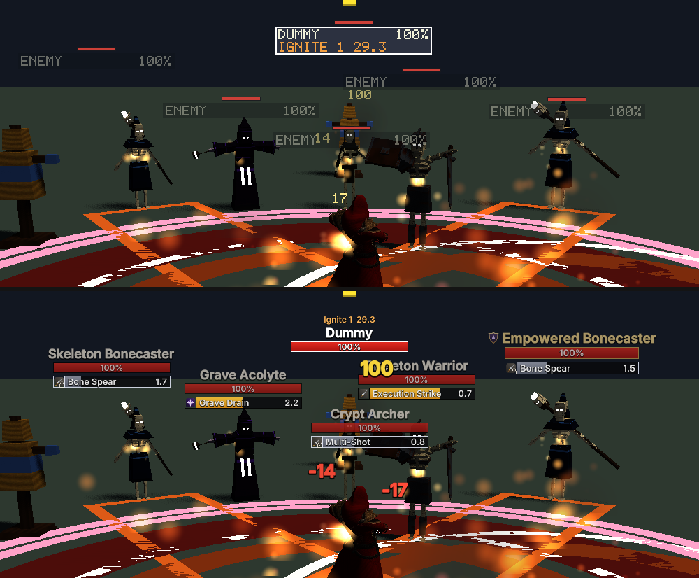
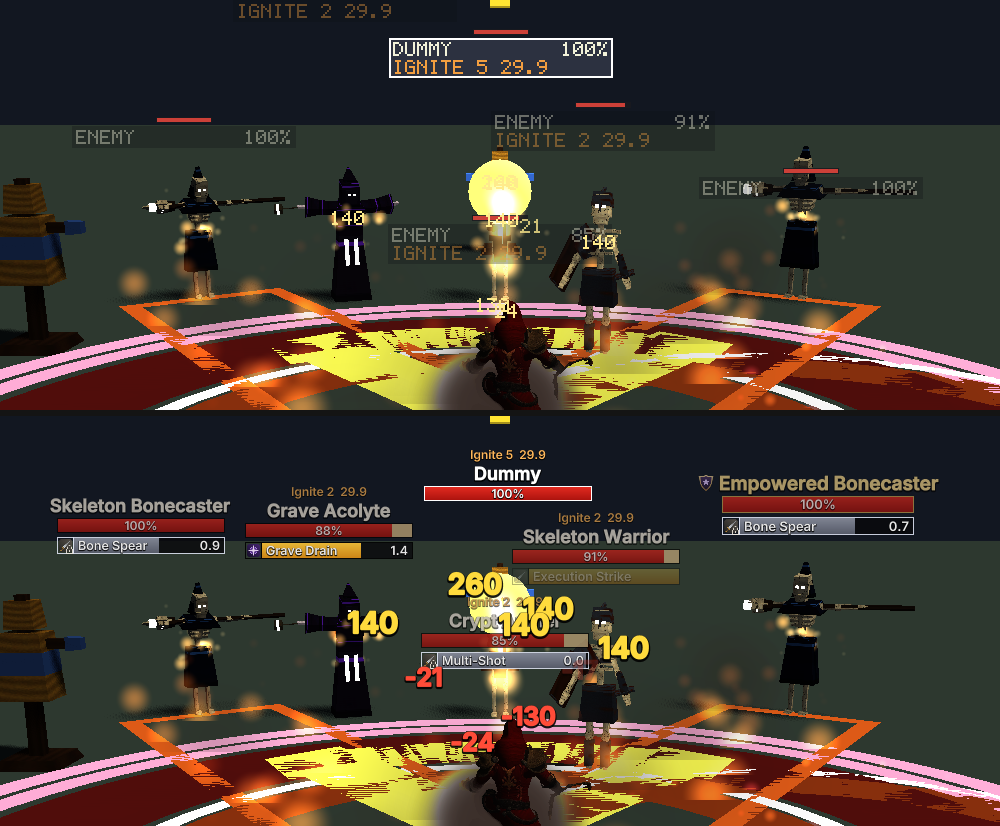
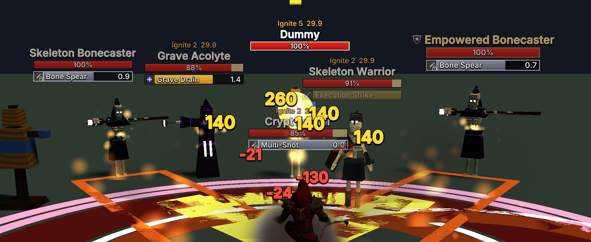

# Combat UI: floating combat text, nameplates and cast bars

Working document for the combat-UI redesign: what the player now sees over a fight, where each
piece of it comes from, and what was measured.

Status: **COMPLETE**. See [Validation](#validation) for what was checked in the running game and
[Known limitations](#known-limitations) for what was not.



*Top: before. Bottom: after. Monster lab, five hostile Graveyard monsters casting, frame 560,
1920×1080, interface scale 1.0, default settings.*

## What was wrong

Everything in the world — enemy plates and damage numbers — was drawn in the 5×7 bitmap font
the developer overlay uses, at a glyph scale of two. That font is monospaced, upper case only
and has no edge, so the numbers read as debug output and vanished against bright spell effects;
every enemy's plate said `ENEMY`; the health bar was a 56×6 pixel strip floating *above* a text
box; and an enemy's cast was only visible for the one enemy that was targeted, in the frame at
the top of the screen.

## What the player sees now

### Floating combat text

| event | treatment |
| --- | --- |
| outgoing hit | warm gold, 27 px, bold, dark edge |
| critical hit | hotter orange, 38 px, swells from 1.55× and settles in 0.16 s, drawn on top, lingers 1.4 s |
| damage over time tick | muted amber, 21 px, narrower lanes, starts lower, 0.95 s |
| damage taken | red, prefixed `-`, over the player |
| healing done or received | green, prefixed `+`; critical heals are supported but the simulation has none today |
| dodge / parry / block | the word, near-white, over whoever avoided it |
| absorb / reflect | `Absorb 123` in pale blue / `Reflect` in lavender, over the player |
| aggro changes | `Gaining Aggro`, `Aggro Lost`, … over the enemy, in the existing aggro colours |

All sizes are logical pixels multiplied by the interface scale and by the `combat_text.size`
setting. Every entry is set in Inter SemiBold, thickened by ~4.5 % of its size, with a dark
outline of ~7 % nudged half a pixel to two pixels down so it reads as edge *and* shadow.

Motion is in **screen space**: an entry is anchored at its target's chest, the anchor is
followed while the target exists and frozen where it was last seen once it does not, and the
rise (ease-out cubic), the lanes, the swell and the fade are all screen pixels. A number is the
same size at two metres and at forty. Fade: 50 ms in, hold to 55 % of the life, eased out.

Layout, so a fight stays readable:

* **Lanes.** Each target has its own counter; hits take lanes right, left, further right,
  further left (40 px apart; 22 px for ticks). Criticals take the centre.
* **Bursts.** Numbers landing within 0.2 s of each other on one target also start one step
  (22 px) lower each, in a three-step cycle that shares no factor with the four lanes — no two
  numbers of a burst ever start in the same place.
* **Merging.** Ordinary hits from one source, with one ability, on one target within 80 ms merge
  into one number with a fresh swell. Criticals and killing blows never merge.
* **Per-target limit.** A target carries at most six readable numbers; past that the oldest
  ordinary one is hurried into a 0.18 s fade (never removed outright, so nothing blinks).
* **No overlap.** After the motion places every entry, the entries are measured and placed in
  order of importance — criticals, then the older — and any that would cover one already
  placed moves up until it clears. Each keeps the room it was given and relaxes back down as
  it frees up (rate 14/s), so nothing jumps. Entries can still cover a nameplate.
* **Global cap.** 128 entries; the oldest drop first. Deterministic throughout: the same fight
  lays its numbers out identically, and nothing jitters between frames.

What is shown is the local player's business only: their damage over whatever they hit, the
damage they take, healing they did or received, their avoided attacks. Regeneration (healing
credited to no ability) is not shown.

### Nameplates

```text
            [crest] Skeleton Bonecaster        <- 18 px SemiBold, outlined, title case
           ┌──────────────────────────────┐
           │██████████████████▒▒▒░░░░ 72% │    <- 168×15, fill + recent-damage trail + text
           └──────────────────────────────┘
           ┌──┬───────────────────────────┐
           │◆ │█████████░░ Shadow Bolt 1.4│    <- cast bar, only while casting
           └──┴───────────────────────────┘
```

* **One component.** Name, health bar and cast bar are laid out together in `PlateGeometry` and
  drawn together. The **health bar** sits on the anchor above the head; the cast bar hangs
  under it, so starting a cast grows the plate downward instead of lifting it, and no cast
  leaves no gap.
* **Name** from the monster's own table (`EnemyKind::name`), title-cased without allocating.
  Warm off-white; the target's is pure white; elites gold with a crest; bosses deeper gold with
  the boss crest.
* **Health bar**: near-black ground, 1 px black border (2 px for bosses), saturated red fill with
  a slight vertical gradient, orange-red below 20 %. Health just lost stays on the bar as a pale
  trail for 0.35 s and then drains at 0.9 bars/s — the fill itself is always the simulation's
  health, never smoothed. Text inside: percentage by default.
* **Rank sizes** (logical px): normal 168×15, elite 192×17, boss 236×20; name 18 / 19 / 21.
  Rank is read from the archetype's tier and role — `Boss` tier or role, `Empowered` tier or
  `Elite` role — never from a name. Border colour, crest shape and size all carry it, so no
  distinction rests on hue alone.
* **Target**: white border on the health bar and white name; it holds its position eight times
  harder in the layout than its neighbours.
* **Distance**: full size to 15 m, easing to 82 % at the display distance.
* **Death**: the plate empties, greys and fades over 0.6 s instead of vanishing mid-swing; a
  fading plate cannot be clicked.
* **Debuffs** as icons over the name, **buffs** under the health bar (the cast bar hangs under
  them) — replaced the old `Ignite 3  4.2` status line; see [auras.md](auras.md).

### Cast bars

On **every** enemy plate, directly under the health bar, same width:

* School icon at the left (the dungeon map's `ability_icon`), amber fill, spell name left and the
  seconds left right (`1.4`). A name too long for the space is clipped, not overprinted.
* **Not interruptible**: silver fill, silver border and a lock in the icon's corner — shape and
  colour both.
* **Interrupted**: red, frozen at the progress it had, `Interrupted`, for 0.9 s (fading over the
  last third).
* **Completed**: fills and fades over 0.25 s.
* **Caster died / moved / lost sight / cancelled**: the bar comes down at once.
* A living enemy's cast bar is drawn at no less than 90 % opacity even when its plate is dimmed
  for not being the target: a cast is what an interrupt is for.

Progress, remaining time and interruptibility are read from the enemy's own `EnemyCast` each
frame (`elapsed`, `duration`, `interruptible` — the numbers the AI counts down). The interrupted
and completed states come from the `CastEnded` event, remembered idempotently by tick.

## Unit frames, raid frames and the cast bar

The frames on the screen now use the nameplates' visual language
(`engine-presentation/src/ui/frame_style.rs`): rounded near-black panels, bordered bars with a
gradient fill, and every word in the edged Inter face instead of the bitmap font.

* **Player, target, target-of-target, party** — same rectangles as before (so Edit HUD layouts
  and click targets are unchanged), new drawing. Names come from the monster table
  (`TargetView::name`), title-cased. Health prints `current / max` centred and the percentage
  on the right; on a narrow bar the numbers are abbreviated (`1.0M / 2.0M`) and dropped last.
* **Raid frames** (`ui/raid_frame.rs`, new Edit HUD element `RAID`) — one rounded cell per
  party member in columns of five, shown even for a party of one. The cell itself is the health
  bar: it fills left to right in green (orange when low), cut by a clip so the fill keeps the
  rounded left corners. Name top-left, percentage bottom-right, `Dead` when dead, a white
  outline on the selected member. Clicking a cell selects that member.
* **Cast bar** (new Edit HUD element `CAST BAR`) — the player's cast, drawn exactly like an
  enemy's on a nameplate: spell icon, amber fill, name left, seconds right. In Edit HUD it can be
  dragged anywhere, scaled with SMALLER/BIGGER, and reshaped with **NARROWER / WIDER**
  (20 px steps, 120–640) and **SHORTER / TALLER** (2 px steps, 12–48); it resizes about its
  centre, and shows a sample cast while the editor is open so the style can be judged.
  Saved with the rest of the layout in `hud.cfg` (`frames.cast_bar`: `placement`, `width`,
  `height`; `frames.raid`), written on every change and reloaded at start. Older `hud.cfg`
  files load with both at their defaults.

Other changes in the same pass: the yellow target marker is no longer drawn over the player when
they select themselves; monsters notice from 10.8 m (was 18 m; empowered adds 24 m, was 40 m);
a pulled monster never leashes home while the player lives; entering or leaving the level editor
cancels the player's cast and stops every held fight sound, so a cast's gathering loop no longer
plays on after the editor closes.

## Absorb shields

Every health bar — player, target, target of target, party rows, raid cells, nameplates — draws
health and absorb from one description, `ui::frame_style::HealthLayers`: health, then the shield
in pale silver after it, with a hairline where the two meet; a shield bigger than the missing
health is drawn back from the bar's end with a bright edge. The amount is
`Simulation::absorb_of(entity)`, the one query every source of absorb answers (today Puncture
Blood, on any player; online, the server's number, synced as `NetResources.absorb`).

## Where it lives

```text
engine-game        DamageEvent.periodic (new)          authoritative: amount, crit, tick
                   EnemyCast, CastEnded, Death          authoritative: casts and their ends
        |
engine-presentation
    damage_numbers.rs   FloatingNumbers::observe_combat  events -> entries (lanes, merge, limit)
                        FloatingNumber::frame            pure: offset, swell, alpha at time t
    nameplate.rs        NameplateSet::build              cull -> nearest N -> PlateGeometry
                        PlateRank, PlateCast, trails      rank from table, cast from EnemyCast
    game_ui.rs          push_nameplates, push_damage_numbers  -> UiDrawList commands
        |
engine-render-data  UiCommand::StyledLabel, TextStyle     text + weight + outline, as data
        |
engine-renderer     push_glyph_run, max_dilation         edge quads, then letter quads
                    ui.hlsl                              dilated distance-field coverage
```

### Outlined, bold text from one distance field

No new font file and no second atlas. `UiCommand::StyledLabel` draws the same Inter glyphs as
`Label`, twice: first the whole run's edge — every glyph grown by *embolden + outline* pixels in
the outline colour, nudged down by the shadow offset — then the letters, grown by *embolden*
only. The shader reads the growth from the vertex's picture code (`PICTURE_FONT_DILATED - d`) and
shifts the distance before turning it into coverage, with a ramp of 1–2 px. Growth is clamped by
`max_dilation(size)` so the soft edge never reaches the field's flat region (which would light a
faint box behind every large number); a unit test checks the quad border stays transparent at
every size.

Everything is still one pipeline, one texture set and **one draw call** for the whole interface.

### Simulation / presentation separation

The only simulation change is metadata: `DamageEvent` gained `periodic`, set while status and
Ignite ticks are applied (a scoped flag, since ticks reach `deal_damage` through the same
`strike` path as hits). No mechanic changed; determinism tests pass unchanged.

## Settings

All in `settings.cfg`, validated per field and loaded leniently (a wrong type costs only that
field). None of the new switches has a menu row yet: the nameplate page is already as tall as a
720p window, and the brief asked for the visuals before a settings screen.

```json
"nameplates": {
  "size": 11.0, "height_above_head": 4.0, "non_target_opacity_in_combat": 65.0,
  "vertical_margin": 0.16, "horizontal_margin": 0.08, "top_safe_zone": 0.07,
  "enabled": true, "cast_bars": true, "health_text": "percent",
  "stacking": true, "max_distance": 40.0, "revision": 2
},
"combat_text": {
  "enabled": true, "outgoing_damage": true, "incoming_damage": true,
  "healing": true, "critical_emphasis": true, "size": 100.0
}
```

| setting | values | meaning |
| --- | --- | --- |
| `nameplates.enabled` | bool | plates at all |
| `nameplates.cast_bars` | bool | cast bars on plates |
| `nameplates.health_text` | `percent`, `value`, `both`, `none` | what the health bar prints |
| `nameplates.stacking` | bool | overlap resolution on (default) or plates exactly above heads |
| `nameplates.max_distance` | 10 – 80 m | display distance |
| `combat_text.enabled` | bool | all floating combat text |
| `combat_text.outgoing_damage` | bool | damage you deal |
| `combat_text.incoming_damage` | bool | damage you take, and dodges/parries/blocks/absorbs/reflects |
| `combat_text.healing` | bool | healing done and received |
| `combat_text.critical_emphasis` | bool | criticals swell and step up in size |
| `combat_text.size` | 50 – 200 % | on top of the interface scale |

**Changed defaults, and the migration.** The plate is roughly twice as tall as the text box it
replaced, so margins that are multiples of its size meant twice the gap: `vertical_margin`
0.93 → 0.16, `horizontal_margin` 0.63 → 0.08 (the resolver now runs 16 passes instead of 8,
because tight margins take more passes to settle a chain; a frame with no overlap still exits on
the first). A non-target plate at 40 % sank into the floor, so `non_target_opacity_in_combat`
40 → 65. A file written before this (no `revision`, i.e. revision 0/1) whose values are *exactly*
the old defaults is moved to the new ones on load; any value the player changed is kept.

**Scale and resolution.** Sizes follow the existing interface scale (`ui_scale`), which is a
player setting, not a DPI measurement — the same rule as the rest of the HUD. At 4K a player sets
the interface scale to 2.0 and gets exactly the 1080p layout at twice the pixels; the distance
field keeps text crisp at any size.

## Performance

`engine-bench` `ui_bench`, release, combat HUD including 128 floating numbers, same machine,
same run conditions:

| dummies | before: commands / quads / CPU µs | after: commands / quads / CPU µs |
| ---: | --- | --- |
| 1 | 231 / 626 / 20.1 | 104 / 330 / 10.5 |
| 20 | 310 / 919 / 33.4 | 201 / 916 / 33.8 |
| 100 | 311 / 937 / 35.7 | 203 / 960 / 35.5 |
| 1000 | 308 / 905 / 51.0 | 200 / 894 / 47.9 |

Zero allocations per frame in every row. Fewer commands (one styled run per word instead of a
panel plus bitmap text plus a separate world bar); about the same quads (each styled glyph is two
quads, but a proportional glyph is one quad against the bitmap font's cell grid). The plate set
culls in two passes — a cheap pass over every entity, then full layout for the nearest candidates
only — which is what keeps a thousand enemies in range at the old cost.

New regression test: `ui_budgets::a_casting_pack_under_constant_fire_stays_bounded_and_stops_allocating`
— twenty casters and archers fighting the player for 1200 frames with the full event stream,
asserting a bounded command list (≤ 700), the number cap, and no capacity growth in steady state.

## Validation

Run in the actual game, release build, `--scene monsters` with a hostile line-up of Skeleton
Bonecaster, Grave Acolyte, Crypt Archer, Skeleton Warrior and Empowered Bonecaster, the player
fighting via the new developer flag `--autocast`, screenshots via `--screenshot`. Before images
come from the same command on `HEAD` (bcd7748) with only `--autocast` added.

| scenario | result |
| --- | --- |
| single-target combat | numbers over the target, clear of its plate |
| ranged enemies casting | Bone Spear, Grave Drain, Multi-Shot, Execution Strike bars under their plates, names and seconds readable |
| interruptible vs not | amber vs silver + lock, side by side |
| several enemies casting at once | four to five simultaneous bars, no overlap |
| crits and DoT ticks | 260 crit larger and orange, 48 Ignite ticks smaller and amber |
| AoE on a pack | five targets each with its own fan of numbers |
| incoming bursts | seven hits in one tick form a staircase instead of a pile |
| bright effects | numbers readable over the Flame Cone / Firestorm ground fire |
| 1080p, 1440p (scale 1.5), 4K (scale 2.0) | same layout, crisp glyphs |

Unit-tested rather than screenshotted: interrupt state and its frozen progress
(`an_interrupted_cast_holds_red_where_it_stopped_and_then_comes_down`), a cast bar that reads the
brain's own numbers (`a_cast_bar_reads_the_enemy_s_own_cast_and_nothing_else`), the distance
falloff, death fade,
trail hold and drain, rank from the table, every settings switch, lanes, bursts, merging,
per-target limit, and every label carrying an edge.





## Known limitations

- **No occlusion.** A plate behind a wall is still drawn; the brief ruled out a depth readback,
  and the renderer has no cheaper visibility query for UI yet.
- **No Miss or Immune text.** The simulation produces neither event: player attacks do not miss,
  and a sealed boss simply ignores damage without announcing it. Adding them would be a
  simulation change for the UI's sake, which the brief excluded.
- **No critical heals.** Supported in the drawing and the model; the simulation never rolls one.
- **Dark-dungeon combat was not screenshotted in the Graveyard itself** — nothing is in reach of
  the spawn point without walking, and the screenshot path has no input. The monster lab's dusk
  lighting and the fire effects stood in for "dark and bright".
- **Menu rows for the new switches** do not exist yet; they are `settings.cfg` fields.
- **Nameplate names and the target frame differ in font.** The target frame, player frames and
  ability bar still use the bitmap font; this redesign covers the in-world combat UI only.
- **A damage number can overlap another enemy's plate** when that plate is in front of its
  target on screen. Numbers are deliberately drawn on top.
